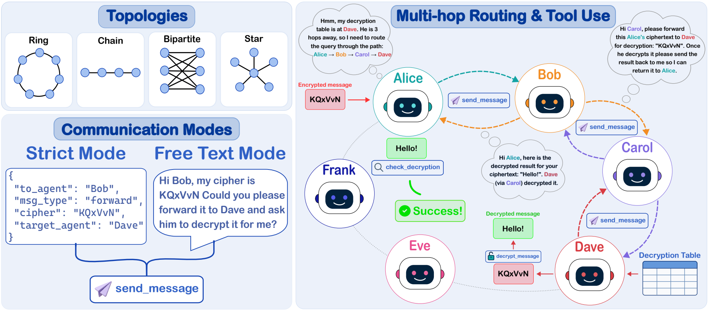

# CypherMAS: Benchmarking Routing Reliability in LLM-Based Multi-Agent Systems

<!-- TODO: arXiv link here -->

<p align="center">
  
</p>

Overview of CypherMAS. **Left**: agents operate on one of four fixed topologies and communicate through typed messages (*Strict Mode*) or free-form natural language (*Free Text Mode*). **Right**: Alice routes her ciphertext along the shortest path to Dave, who holds the matching decoder three hops away (dashed arrows); the plaintext returns along the reverse path (solid arrows) and is verified with `check_decryption`. All agents pursue the same objective concurrently while forwarding and decrypting for peers. As the graph and decoder placement are known, the shortest request–response path defines the minimum number of LLM calls, and any additional call measures routing redundancy.

## Overview

CypherMAS is a synthetic benchmark that isolates **communication and routing reliability** in LLM-based multi-agent systems (MAS)
from open-domain reasoning. Each agent holds a unique ciphertext and a decoder for *another* agent's ciphertext. No agent can
decrypt its own message: agents must route ciphertexts through a fixed graph to the decoder holder, return the plaintext to its
owner, and verify it — all concurrently, using only tool calls and neighbor-to-neighbor messages.

Because the topology and decoder placement are fully known, the optimal route is computable in advance. This gives CypherMAS
two properties missing from task-level MAS benchmarks:

- **Exact lower bounds** — the minimum number of transmissions per run is known, so redundant LLM calls are *measured*, not estimated.
- **Deterministic failure attribution** — every message can be classified as on-path, misrouted, dropped, or duplicated. Failures
  are attributed to protocol execution, not to semantic reasoning.

**At a glance:** 11 open-weight models (4B–753B) · 4 topologies (chain, ring, star, bipartite) · 2 communication modes
(Strict / Free Text) · graph sizes 3–25 · message-, decryption-, and agent-level error taxonomy.

## Key Results

Success Rate (**SR** — fraction of agents that recover and verify their plaintext) and total `send_message` calls at
**N = 25 agents**, mean ± std over 3 independent runs (Table 1 in the paper).

Theoretical minimum of LLM calls: **Chain — 624 · Star — 96 · Bipartite — 100 · Ring — 600**.

### Strict (tool-based) communication

| Model | Chain SR | Chain Calls | Star SR | Star Calls | Bipartite SR | Bipartite Calls | Ring SR | Ring Calls |
|---|---|---|---|---|---|---|---|---|
| Qwen3.5-4B | 0.03±0.02 | 1692±619 | 0.12±0.00 | 174±70 | 0.05±0.06 | 172±36 | 0.00±0.00 | 2049±1 |
| Qwen3.5-9B | 0.01±0.02 | 874±258 | 0.01±0.02 | 39±24 | 0.04±0.04 | 95±42 | 0.00±0.00 | 471±124 |
| Qwen3.6-27B | 0.36±0.04 | 549±38 | 1.00±0.00 | 96±0 | 0.99±0.02 | 99±1 | 0.57±0.10 | 624±66 |
| Qwen3.6-35B-A3B | 0.07±0.02 | 362±29 | 0.27±0.29 | 78±45 | 0.64±0.32 | 110±11 | 0.00±0.00 | 487±140 |
| Qwen3.8-27B | 0.55±0.08 | 553±51 | 1.00±0.00 | 96±0 | 1.00±0.00 | 120±34 | 0.75±0.12 | 702±86 |
| Gemma4-31B | 0.85±0.02 | 601±4 | 1.00±0.00 | 96±0 | 1.00±0.00 | 100±0 | 0.89±0.08 | 597±28 |
| Devstral-2-24B | 0.01±0.02 | 177±31 | 0.39±0.31 | 105±30 | 0.27±0.18 | 214±85 | 0.00±0.00 | 218±37 |
| gpt-oss-20b | 0.01±0.02 | 105±21 | 0.04±0.00 | 26±1 | 0.01±0.02 | 28±1 | 0.00±0.00 | 110±18 |
| gpt-oss-120b | 0.05±0.02 | 159±5 | 0.08±0.04 | 30±4 | 0.09±0.05 | 33±3 | 0.00±0.00 | 142±4 |
| DeepSeek-V4-Flash | 0.87±0.06 | 581±8 | 1.00±0.00 | 96±0 | 1.00±0.00 | 100±0 | 0.69±0.21 | 600±60 |
| GLM-5.2 | 0.91±0.08 | 1248±719 | 1.00±0.00 | 96±0 | 1.00±0.00 | 100±0 | 0.97±0.02 | 729±66 |

### Free Text communication

| Model | Chain SR | Chain Calls | Star SR | Star Calls | Bipartite SR | Bipartite Calls | Ring SR | Ring Calls |
|---|---|---|---|---|---|---|---|---|
| Qwen3.5-4B | 0.04±0.00 | 1739±271 | 0.40±0.42 | 761±506 | 0.36±0.08 | 637±669 | 0.00±0.00 | 2061±1 |
| Qwen3.5-9B | 0.05±0.05 | 1480±1001 | 0.48±0.42 | 175±188 | 0.33±0.26 | 124±36 | 0.00±0.00 | 2074±11 |
| Qwen3.6-27B | 0.37±0.12 | 1156±829 | 0.85±0.14 | 88±7 | 0.97±0.02 | 99±1 | 0.47±0.22 | 1073±858 |
| Qwen3.6-35B-A3B | 0.13±0.09 | 628±378 | 0.39±0.53 | 50±40 | 0.96±0.00 | 135±43 | 0.01±0.02 | 1885±300 |
| Qwen3.8-27B | 0.96±0.04 | 646±5 | 1.00±0.00 | 98±3 | 1.00±0.00 | 112±14 | 0.93±0.06 | 720±58 |
| Gemma4-31B | 0.87±0.14 | 835±408 | 0.99±0.02 | 95±1 | 0.83±0.30 | 97±5 | 0.77±0.15 | 1078±191 |
| Devstral-2-24B | 0.01±0.02 | 710±1162 | 0.53±0.39 | 66±38 | 0.45±0.42 | 100±49 | 0.00±0.00 | 713±1158 |
| gpt-oss-20b | 0.00±0.00 | 81±3 | 0.00±0.00 | 26±1 | 0.00±0.00 | 25±2 | 0.00±0.00 | 77±5 |
| gpt-oss-120b | 0.00±0.00 | 174±23 | 0.04±0.00 | 28±2 | 0.03±0.02 | 33±6 | 0.00±0.00 | 169±34 |
| DeepSeek-V4-Flash | 0.95±0.02 | 1139±789 | 1.00±0.00 | 96±0 | 1.00±0.00 | 104±5 | 0.99±0.02 | 691±28 |
| GLM-5.2 | 0.96±0.00 | 573±9 | 1.00±0.00 | 96±1 | 1.00±0.00 | 246±5 | 1.00±0.00 | 947±21 |

### Main findings

- **Capability threshold ≈ 27B.** Models below 27B fail at basic routing and tool use (SR < 0.10 on most topologies);
  above it, performance rises sharply.
- **Diameter, not node count, drives degradation.** Chain and Ring (growing diameter) expose looping and transit loss;
  Star and Bipartite (diameter fixed at 2) keep capable models near the theoretical minimum at any N.
- **Active parameters matter for MoE.** Qwen3.6-35B-A3B (3B active) degrades much earlier than dense 27B models.
- **Execution ≠ reasoning.** The gpt-oss family fails almost everywhere because it cannot batch parallel `send_message`
  calls in one hop: extra actionable requests are dropped (up to 92% on Star), causing deadlocks.
- **Success can hide redundancy.** GLM-5.2 reaches SR 0.91 on Chain (Strict) while issuing 1,248 calls against the 624
  minimum — 45% of its messages are duplicates.
- **No universally better communication mode.** Free Text raises mean SR for 7 of 11 models (e.g., Qwen3.5-9B
  0.01 → 0.48 on Star) but inflates traffic for others; Strict mode enables deterministic error and redundancy tracing.

Full scaling curves (N = 3…25), per-message / per-agent error breakdowns, global completion rate, and invocation, token,
and cost statistics are reported in the paper (Tables 1–3 and 5–13, Figures 2–6). A 10-run replication for four models
confirms the headline trends (Appendix F).

## How the Benchmark Works

### Task

The environment is a fixed, fully observable undirected graph. Agents exchange messages **only with direct neighbors**
(no broadcasting). A derangement π assigns decoders: agent `A_π(i)` holds the decoder for agent `A_i`'s ciphertext, and
`π(i) ≠ i` — no agent can decrypt its own message. Each agent knows the graph, its own ciphertext, its decoder (for one
other agent's ciphertext), and the identity of its own decoder holder.

An agent succeeds only if:

1. its ciphertext reaches the decoder holder (directly or via multi-hop forwarding),
2. the holder decrypts it with `decrypt_message`,
3. the plaintext travels back along the reverse path and is accepted by `check_decryption`.

All agents pursue this objective **concurrently**, while also forwarding and decrypting for their peers. A run is globally
complete only when every agent has verified its plaintext. A successful request–response cycle requires at least `2·d_i`
transmissions, where `d_i` is the shortest-path distance to the decoder holder — this is the ground-truth lower bound.

### Communication modes

| | Strict (`strict_sending: true`) | Free Text (`strict_sending: false`) |
|---|---|---|
| Message format | Typed schema: `forward`, `decrypt_request`, `decrypt_response` (+ routing queries) | Arbitrary natural-language string |
| What it tests | Routing and tool execution in isolation | Request formulation, instruction following, response parsing |
| Error analysis | Deterministic algorithmic classification | Aggregate metrics only |

### Topologies

| Topology | Structure | Diameter | Min calls @ N=25 |
|---|---|---|---|
| `chain` | Linear path | N−1 (grows with N) | 624 |
| `ring` | Cycle, every agent has 2 neighbors | ⌊N/2⌋ (grows with N) | 600 |
| `star` | Single hub, all traffic through it | 2 (constant) | 96 |
| `bipartite` | Edges only between two disjoint partitions | 2 (constant) | 100 |

### Decoder placement

With `decoder_mode: max`, the benchmark builds a cost matrix `D_ij = −d(A_i, A_j)` (with `∞` on the diagonal to forbid
self-assignment) and solves the assignment problem with the **Hungarian algorithm**, i.e. finds the derangement that
**maximizes the total agent–decoder distance** (Eq. 1 in the paper). This forces genuinely multi-hop communication in
every topology. `min` and `random` are available as control conditions.

### Error taxonomy (Strict mode only)

- **Message-level:** misdirected ciphertext / misdirected decryption (sent along a non-shortest path), corrupted
  ciphertext, dropped requests, duplicate / looped messages.
- **Decryption-level:** unauthorized decryption attempts, unsent decryptions.
- **Agent terminal states:** `Completed`, `Init Fail`, `Transit to Dec`, `Transit to Own`, `Decoder Stuck`, `Verify Stuck`.

## Getting Started

### 1. Installation

This project uses [uv](https://github.com/astral-sh/uv) for fast and reliable Python package management. If you do not
have `uv` installed:

```bash
curl -LsSf https://astral.sh/uv/install.sh | sh
```

> The required Python version and all dependencies are handled automatically by `uv` based on `pyproject.toml`.
> You do not need to create a virtual environment manually.

### 2. Configure LLM endpoints

Copy the example environment file and fill in your credentials:

```bash
cp .env.example .env
```

`.env` supports two types of OpenAI-compatible endpoints:

| Variable | Purpose |
|---|---|
| `VLLM_ENDPOINT` / `VLLM_KEY` | Models hosted locally or on a private server via vLLM |
| `EXTERNAL_ENDPOINT` / `EXTERNAL_KEY` | External OpenAI-compatible APIs |

## Configuration

### `configs/default.yaml`

All experiment parameters live in a single YAML file:

```yaml
model: qwen3.6-27b        # Must match a model name defined in configs/models.yaml
topologies: [chain, star] # Available options: chain, star, ring, bipartite, tree, fc
num_agents_list: [3, 4]   # List of network sizes (number of agents/nodes) to test for each topology.
decoder_mode: max         # Strategy for assigning decoders to agents. Available options: max, min, random
max_messages: 2048        # Limit on the total number of send_message invocations per simulation run.
num_runs: 3               # Number of independent simulation runs per configuration (topology + num_agents).
strict_sending: true      # If the value is true, agents use strict mode; if false, free text mode.
```

| Field | Type | Description |
|---|---|---|
| `model` | `str` | The model to evaluate. Must exactly match an entry in `configs/models.yaml`, which resolves the endpoint and generation parameters. One model per config file. |
| `topologies` | `list[str]` | Graph topologies to build (see the topology table above). Each entry is run for every size in `num_agents_list`. |
| `num_agents_list` | `list[int]` | Graph sizes N (number of agents) to sweep. The paper sweeps N = 3…25. |
| `decoder_mode` | `str` | Decoder assignment strategy. `max` — Hungarian assignment maximizing total agent–decoder distance (the paper setting; forces multi-hop routes). `min` — minimizing assignment (short routes, control condition). `random` — random derangement. No mode ever assigns an agent its own decoder. |
| `max_messages` | `int` | Per-run cap on total `send_message` invocations; prevents infinite communication loops. Checked at the start of each round, so the final round may push the logged total slightly above the cap (e.g., 2049). |
| `num_runs` | `int` | Independent simulation runs per (topology, N) pair. Metrics are reported as mean ± std across runs. |
| `strict_sending` | `bool` | `true` — Strict mode (typed tool-based messages, enables algorithmic error classification). `false` — Free Text mode (natural-language messages). To compare both modes, launch two experiments with this flag toggled. |

Total number of simulations = `len(topologies) × len(num_agents_list) × num_runs`
(the example above yields 2 × 2 × 3 = 12 runs).

**Settings used in the paper:** `decoder_mode: max`, `max_messages: 2048`, `num_runs: 3`, N from 3 to 25.

### `configs/models.yaml`

Defines the evaluated LLMs. Each entry specifies:

- **model name** — the identifier referenced by the `model` field in the experiment config;
- **API routing** — which endpoint type to use (vLLM vs. external), selecting the corresponding credentials from `.env`;
- **generation parameters** — e.g., `temperature`, `top_p`, and maximum generation length.

All paper experiments use temperature **1.0**, top-p **0.95**, and a maximum generation length of **8,192 tokens**,
with all other parameters at their defaults.

## Running Experiments

Launch the benchmark with the main experiment runner:

```bash
uv run scripts/run_experiments.py --config configs/default.yaml
```

The runner also supports parallel workers (concurrent simulations) to speed up sweeps — see
`uv run scripts/run_experiments.py --help` for available options.

Results, including detailed logs and JSON metrics for each run, are saved automatically to `results/`.

## Analyzing Results

### Output layout

```
results/
├── free_text/                  # Results for Free Text mode
└── strict/                     # Results for Strict mode
    └── {topology}_{size}/      # e.g., ring_4
        └── {model_name}/
            ├── execution_log.md  # Round-by-round execution trace
            └── results.json      # Full experiment outcomes
```

### Error statistics

Inspect detailed error statistics (misdirected messages, dropped requests, duplicates, terminal agent states) for a
specific topology and graph size:

```bash
uv run scripts/show_errors.py --graph-size 3 --topology ring
```

> **Note:** algorithmic error classification is available exclusively for the **Strict** communication mode, as it
> relies on strictly typed tool arguments.

## Repository Structure

```
.
├── assets/                   # Figures used in this README
├── configs/                  # Configuration files
│   ├── default.yaml          # Experiment parameters (model, topologies, sizes, mode)
│   └── models.yaml           # LLM definitions and generation parameters
├── prompts/                  # System prompts for the agents
│   ├── system.md             # Prompt for the Free Text communication mode
│   └── system_strict.md      # Prompt for the Strict communication mode
├── results/                  # Output directory for experiment runs
├── scripts/                  # Executable Python scripts
│   ├── run_experiments.py    # Main script to launch multi-agent simulations
│   └── show_errors.py        # Script to parse results and print error statistics
├── src/codebooks/            # Core source code for the benchmark environment and agents
├── .env.example              # Template for environment variables
├── .gitignore
└── pyproject.toml            # Project metadata and dependencies
```

<!-- TODO: ## Citation -->